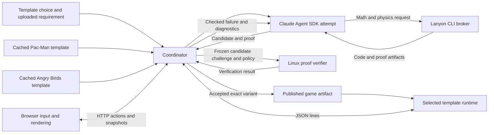

# Architecture for proof guided game generation

Use one game-agnostic harness with cached, game-specific templates. For each request, the Claude Agent SDK works from the selected template and an immutable copy of the user's formal requirement. It proposes a game variant and proof evidence, receives check failures, and revises the candidate until the independent verifier accepts it. The verified claim must apply to the game behavior the player actually encounters.

This is the implementation plan. The repository currently contains the project instructions and hackathon rules; the game, runner, and proofs still need to be built.

## Product scope

The demo has two templates: a Pac-Man-style maze and an Angry Birds-style physics game. A user selects a template, uploads a Lean requirement with optional supporting proofs, and supplies a creative brief. The agent generates a new version on top of that template. The shared harness knows how to run a template; it does not define a common maze, physics engine, or win condition.

Each request can combine hard formal requirements with design preferences. Examples of hard requirements include an enemy count, a reachable area, or the absence of a winning sequence under a stated player model. Preferences such as "looks solvable" or "feels difficult" guide generation and playtesting. They are not proved unless the user supplies a precise, reviewed formal definition.

| Template | Candidate variations | Example property and reveal |
| --- | --- | --- |
| Pac-Man | Maze, collectibles, ghost positions and behavior, and presentation within the template's allowed changes. | A route exists through the maze when ghosts are ignored, the player can make progress, but no allowed sequence wins under the stated ghost rules. Show the checked impossibility evidence and, where available, a replay. |
| Angry Birds | Bird launch controls, targets, obstacles, layout, and presentation within the template's allowed changes. | No shot in the specified control set reaches the target under the actual game physics. Show the checked scope and, where available, a replay. |

These examples are candidate specifications, not existing proofs. The user owns the uploaded specification. A game may be unwinnable while still allowing exploration; whether it feels plausible or fun requires playtesting.

## Cache the template, isolate each attempt

A template is a versioned package with:

- A playable game skeleton and a defined runtime entry point.
- The game rules, state and input semantics, win condition, and the permitted candidate changes.
- The variant representation, build and play commands, and any template-specific checks or visualizations.
- A Lean specification interface, example requirements, and proof or certificate support for the properties it offers. State exactly how those proofs relate to the executable game.
- Pinned dependencies, a build recipe, and any physics tools it needs.

Cache template dependencies and compiled modules. These are reusable work, rather than a collection of generated answers. Templates may support different representations, so the harness uses a small common adapter for preparing an attempt, building and running a variant, and returning diagnostics. The coordinator owns the acceptance policy; a template's reported score or agent response cannot approve a proof by itself.

Define the template identity from the toolchain, dependency manifest, source files, data schema, and build recipe. Define the request identity from the exact uploaded requirement and its dependency closure. Every attempt has a fresh working directory and private build output. Do not share a writable `.lake` directory between jobs. Start with one generation job at a time.

The agent receives a read-only copy of the selected template, the frozen request, a seed, the brief, and structured feedback from previous attempts. It writes candidate data and, when the template permits it, candidate code only in that attempt's writable area. It may also submit certificates and Lean proofs. The template defines and validates its candidate representation; generated source cannot change the frozen requirement, trusted challenge, verifier policy, or template's protected definitions. Enforce these limits in the runner's tools and filesystem permissions. Instructions in the prompt explain the limits; they do not enforce them.

Changing only level data is the first path to a demo. If a template permits changes to game mechanics, the accepted proof must cover those changed mechanics and their actual runtime behavior too. A proof about the original skeleton does not automatically cover new code.

When an attempt fails, return the failed condition, Lean diagnostics, and any checked counterexample. The agent revises its allowed outputs and the harness checks again. Changing a candidate creates a new attempt and invalidates its previous proof result. Allow cancellation and configurable time or cost limits; an unavailable verifier or exhausted limit is not an accepted result. A contradictory or difficult requirement may never yield a passing candidate.

For each request, use a new seed and compare the template's normalized variant representation with previous results. Changing only a title does not count as a new game variation. If no different result is found before a configured limit or cancellation, report that outcome. Do not promise unlimited unique variants.

## Shared harness and template ownership

Use one Python coordinator for jobs, sessions, and the Claude Agent SDK loop, with separate game-specific implementations behind the template adapter. The coordinator also serves the browser UI. No separate job service or database is needed for the local demo.



The selected runtime owns game state and decisions. The browser sends inputs and displays snapshots and events. Gameplay checks, replays, and proof evidence must refer to the same rules used in play, including collision, physics, enemy behavior, input timing, randomness, and victory where relevant. Visual interpolation may run in the browser, but an unverified browser-side collision or timing rule cannot be presented as proved.

Keep four code owners:

| Owner | Responsibility |
| --- | --- |
| `templates/` | The Pac-Man and Angry Birds game skeletons, adapters, game-specific specs, examples, and proof support. |
| `Specs/` | Shared upload-security specifications and examples, separate from their implementation. |
| `Verification/` | Trusted challenge construction, proof checks, acceptance policy, and audit commands. |
| `app/` | Upload intake, template cache, Claude Agent SDK loop, Lanyon broker, Linux verifier invocation, publication, sessions, and browser UI. |

The verifier policy and trusted challenge live outside the agent's writable directory. They are coordinator-owned inputs, not generated solution files.

The public operations are `generate(request)`, `jobStatus(jobId)`, `startSession(artifactId)`, and `act(sessionId, sequenceNumber, action)`. `act` rejects a stale sequence number so a retried browser request cannot apply a move twice. Each template defines how its runtime orders and times inputs; any timing used by a proof must match play. Only the coordinator's verifier result can create an accepted artifact. Agent output is always a proposal.

## What an uploaded spec or proof means

Accept one Lean source file per request, paired with the selected template. Its required export is `UserSpec.requirement : SelectedTemplate.Variant -> Prop`, where `SelectedTemplate.Variant` is supplied by that template's pinned Lean interface. It may import the selected template's allowed game and specification modules and include helper lemmas or an existing proof. Do not accept uploaded archives, Lake files, dependency downloads, compiled modules, or executables. Build all uploaded source inside the verifier sandbox, including during intake.

Freeze the uploaded source and all definitions its predicate depends on before generation. Preserve these bytes across repairs. A helper theorem is useful only if its conclusion applies to the generated level and the solution proves all its premises. A proof about an earlier level does not certify a new level.

The final candidate theorem has no unproved assumptions and states this conjunction for the selected template and frozen candidate:

```text
SelectedTemplate.WellFormed variant
  AND SelectedTemplate.Playable variant
  AND UserSpec.requirement variant
```

These names describe the contract; each template defines the actual types and predicates in its own spec files. `WellFormed` checks that the game can be constructed. `Playable` captures the template's reviewed minimum interaction requirements and need not imply that the game can be won. Neither predicate may be made vacuously true to pass a check. List each main theorem's transitive project definitions with a multi-module version of `#spec_surface`.

Define interaction and proof scope per template, including for an impossible game:

- Pac-Man can require a nonterminal start, a minimum number of safe moves or reachable tiles, and a geometric route through the maze when ghosts are ignored. The real play and proof include the ghosts; a wall-only route is not a winning proof.
- A minimum starting enemy count can be stated and checked. On its own, the count does not prove that the game is hard or unwinnable.
- Angry Birds can require a nonterminal start and at least one launch the player can perform. Its checks must include the stated aim and power controls, physics, collision behavior, and win condition. A launch being possible does not imply a target can be hit.
- A "no win" claim covers all action sequences allowed by the stated game and player model. If it covers a finite time horizon, a discrete set of shots, particular seeds, or an input-speed limit, put that restriction in the theorem and the result shown to the user.
- A claim about demanding timing must define what inputs are allowed and what the player can observe. The proof applies to that chosen model; it does not prove that every human has a particular reaction speed or cannot anticipate a deterministic event.

For each published template, choose its actual minimum interaction predicate and demonstrate a concrete accepted example with all hypotheses discharged, plus known-bad examples it rejects. Where a template offers both winnable and unwinnable modes, give a concrete example of each. These predicates do not prove that a game looks fair or is fun; playtesting still decides that.

Custom Lean predicates may be too weak, inconsistent with a template's interaction requirements, or too hard to prove within the budget. Display the exact requirement and its definitions for review. Use a label such as "Unwinnable" only for a recognized, reviewed predicate. For an arbitrary upload, say "Checked against your uploaded requirement" rather than inferring a meaning from its filename or description.

## Upload security properties

Formally verify two properties of the executable Lean upload code:

1. **Path traversal and overwrite prevention.** The storage decision ignores the supplied filename and constructs a destination from a server-generated, fixed-length lowercase hexadecimal identifier and a fixed filename. Prove that every accepted destination has that shape and that changing the supplied filename cannot change it. The filesystem adapter must create files exclusively within a private directory, reject identifier collisions, and avoid following untrusted links; test these operating-system behaviors separately.
2. **Oversized upload prevention.** The upload route passes each incoming chunk through the Lean streaming limit code before writing it. Prove that the cumulative bytes it accepts and permits to be written for one upload never exceed the configured limit. A file exactly at the limit is allowed; a chunk that would exceed it is rejected, the partial upload is discarded, and the request cannot proceed. Do not buffer the complete request before the check. The HTTP adapter must enforce a bounded chunk size and use this code on the actual upload path.

Keep the two specifications in their own files. Give each theorem a concrete accepted example and examples that reject bad behavior. Show that traversal and absolute-looking filenames cannot change the destination; reject a file one byte over the limit and a chunk that crosses the limit. List the project definitions in each theorem's statement, audit its axioms, and pass Comparator. Test the real HTTP endpoint and filesystem using those cases, including link and collision attempts. The proofs cover the Lean decisions and stream accounting; the HTTP adapter, filesystem operations, and operating-system guarantees remain trusted and need the end-to-end checks.

Lean source may execute commands during compilation. Isolate every upload build in a Linux worker without credentials or network access, with time, memory, and process limits. These controls address malicious code and expensive proofs but are not established by the two upload theorems. The per-upload size theorem also does not bound total storage or simultaneous requests.

## Template-specific proofs and Lanyon

Each template owns the proof methods appropriate to its rules. The agent may search for certificates using ordinary code; that search does not decide acceptance. Reusable Lean checkers can verify a certificate and derive a fact about the executable rules or a verified translation of them.

For a finite-state Pac-Man template, a winning certificate can be an action sequence checked against the actual game transitions. An impossibility certificate can be a set containing the initial state, closed under every allowed action and modeled ghost or randomness choice, with no winning state. Prove the action and choice enumeration complete and preserve all relevant state fields. A finite search timeout or a missing winning route is not an impossibility proof. If the proof checks only a bounded number of steps or a fixed seed, state that limit.

A closed set may include unreachable states. To label an overlay "all reachable states", also establish that each displayed state is reachable, for example with checked predecessor traces. Otherwise label it as the set used by the proof.

For the Angry Birds template, define exactly which game physics, collisions, aim and power values, and timing a claim covers. A proof over a finite set of shots says nothing about other shots unless the template's actual controls are restricted to that set or a separate proof covers the remaining values. A mathematical trajectory model is useful for search, but a proof about that model alone is not a proof about a different physics engine.

The shared harness makes [Lanyon CLI](https://github.com/LanyonVibeCheck/LanyonCLI) available for math and physics tasks. Its documented non-interactive stages can specify a problem, verify it, compile an implementation, and download the Lean proof and C source, for example `lanyon-cli --specify physics.txt --verify --compile --download`. The coordinator runs Lanyon through a controlled broker; the CLI submits requests to a remote Lanyon server. The agent receives its artifacts and diagnostics as candidate evidence, not an automatic acceptance verdict.

For an Angry Birds candidate that uses Lanyon output, freeze the relevant specification and generated artifacts. Check that the proved statement covers the physics and collision behavior the game actually executes, including the allowed input values and numerical assumptions. If the game uses the generated C code, establish and disclose the trusted link between that code and the Lean theorem. If it uses a different engine or a manually written model, report that boundary and do not call the playable engine verified solely because Lanyon proved the model. Check Lanyon's Lean version and dependencies against this project's pinned toolchain and run the required Comparator check before claiming a proof is final.

Use kernel-checked computation and ordinary proof terms. The default policy accepts only `propext`, `Classical.choice`, and `Quot.sound`. Do not use `native_decide` or add computation axioms to make a slow candidate pass. Establish checker soundness, then measure concrete certificate checking at the proposed bounds. A timeout means unresolved, not impossible.

## Acceptance binds the proof to the playable artifact

An attempt becomes playable only through this sequence:

1. Validate and freeze the selected template revision and proposed variant, including any permitted candidate source and relevant Lanyon artifacts. The template validates its own bounded data format. If it emits Lean data modules, a fixed serializer must not interpret string fields as Lean code.
2. Create the trusted challenge for that exact template, variant, frozen uploaded predicate, and the template's reviewed well-formedness and interaction predicates. Freeze the challenge outside the solution directory before accepting its proof. The solution cannot replace any of the definitions used by the statement.
3. Build the affected modules and audit each main theorem's axioms. Reject proof holes, new axioms, forbidden kernel options, meaning-changing unsafe substitutions, unlimited heartbeats, and edits outside the allowed candidate files. Scan source as a supplementary check; kernel replay and Comparator provide the proof decision.
4. Run `lake check`, then `lake comparator` against the coordinator-owned challenge and axiom policy. A failed check, missing check, or verifier error cannot produce an accepted artifact.
5. Build the runtime from the same frozen candidate and template sources in a clean build directory. Uploaded specification and proof modules must not become part of the playable runtime. Establish that the checked semantics cover the rules and physics actually executed, using Lean code directly, a verified compiler, or an explicitly justified translation. A test against a hand-written model is useful evidence, but does not by itself prove that the model and runtime agree. Run a protocol smoke check and replay checked witnesses where applicable.
6. Publish the runtime, display data, requirement, proof evidence, and their hashes together. Sessions load this immutable artifact. The runtime reports its compiled variant and template identities; the coordinator checks these before starting play.

The renderer gets game state from that runtime. A hand-edited preview or an old executable cannot be substituted for the checked variant. Compiling Lean or generated C still trusts the relevant compiler and runtime; the browser, transport, operating system, publication code, and any translation or external contracts also remain trusted. Document these limits per template in the README. The formal claim covers the proved game behavior and uploaded predicate, not visual rendering or the entire application.

Lean 4.35 introduced `lake check` and `lake comparator`, including kernel replay, comparison against trusted statements, and sandboxed builds. Their sandbox requires Linux. Pin `leanprover/lean4:v4.35.0`, commit `lake-manifest.json`, and start with core Lean only. The explicit 4.35 instruction takes priority over the later aspirational mention of 4.53. See the [4.35 release notes](https://lean-lang.org/doc/reference/latest/releases/v4.35.0/) and [Lake checker configuration](https://lean-lang.org/doc/reference/latest/Build-Tools-and-Distribution/Lake/).

Configure Comparator outside the candidate directory with `challenge_module`, `solution_module`, `theorem_names`, and `permitted_axioms`. Establish its trusted challenge/export recipe in the first build checkpoint. Statement placeholders used to construct the challenge are not accepted proofs and must never enter the solution or runtime. The official [proof validation guide](https://lean-lang.org/doc/reference/latest/ValidatingProofs/) explains the distinction between a trusted statement and untrusted proof construction.

The local environment check found no `lean` or `lake` command on the Windows PATH. The Docker CLI is installed but its Linux engine was unavailable; listing WSL distributions returned access denied. Set up or select a working Linux verifier before claiming any proof is final. Do not disable Comparator's sandbox to make the demo pass.

## The Claude Agent SDK loop and demo flow

Use the [Claude Agent SDK](https://code.claude.com/docs/en/agent-sdk/overview) for the agent's tool-use loop. Adapt the session and progress pattern from [Anthropic's autonomous-coding example](https://github.com/anthropics/claude-quickstarts/tree/main/autonomous-coding); its example uses the older `claude-code-sdk`, so use the current `claude-agent-sdk` and check its migration requirements. Skip the example's generic application initializer when a prepared game template already exists.

The coordinator starts an attempt with the selected template and frozen request. Give the agent scoped tools to inspect the template, write only allowed candidate files, run the template's build or play checks, ask for Lean diagnostics, submit a candidate for independent verification, and call Lanyon when needed. Tool permissions and operating-system isolation enforce the boundaries. The agent cannot change the verifier configuration or trusted challenge, and its statement that it is done cannot publish a game. Treat comments in uploaded Lean files as content, not instructions to the agent.

The SDK runs its internal tool-use loop within a session. The coordinator owns the outer loop: freeze a candidate, check it, return useful failures, and resume or start another session until a candidate passes. Persist the request identity, selected template revision, candidate identity, diagnostics, and agent session information between retries. Separate the Linux proof worker, which has no network access or model credentials, from the coordinator's controlled calls to Claude and Lanyon's remote service. An optional [lean-lsp-mcp](https://github.com/oOo0oOo/lean-lsp-mcp) connection can return Lean goals and diagnostics during authoring; its feedback does not replace the final Comparator check. Do not run it and `lake` concurrently in the same checkout.

Use these job states:

```text
received -> checking_upload -> selecting_template -> generating -> checking_candidate -> accepted
                                                           ^          |
                                                           |-- repair-|
```

Terminal alternatives are `invalid_upload`, `budget_exhausted`, `verifier_unavailable`, and `cancelled`. Keep proof rejection diagnostics in the attempt history. A rejected attempt can be repaired; it does not become the published game. No proof found is not a proof that the request is unsatisfiable.

The screen centers on the selected playable game. Place template selection, upload, and generate controls beside it, show real generation status, and offer a template-appropriate explanation after acceptance. Show any player, timing, action, seed, or horizon restrictions beside the claim. Keep raw proof details in an expandable view. An older accepted game can remain playable while a new request runs, with its identity clearly shown.

Ship labeled, previously checked examples so a fresh clone opens a usable game without model credentials. Live generation requires a configured model connection and a ready verifier. An unavailable connection must be visible. Never substitute an example and claim the agent generated it for the current request.

`Makefile` must provide `install` and `run` as required by `RULES.md`. `make install` prepares the pinned dependencies and checked examples; `make run` starts the local app and reports live-generation readiness. Document the supported Linux environment and the Windows route through a Linux worker. Keep model authentication separate from the ability to launch and play the examples.

## Build in this order

| Checkpoint | Deliverable and evidence needed to proceed |
| --- | --- |
| 1. A proof reaches the judge | Pin Lean, commit the manifest, and get a tiny theorem through Linux `lake check` and Comparator. Deliberately change its statement and confirm rejection. |
| 2. Upload security | Implement the actual Lean storage decision and streaming limit, prove the two upload properties, audit their axioms and specification definitions, and pass Comparator. Exercise the real HTTP and filesystem route with traversal names, collisions, link attempts, and uploads at and over the limit. |
| 3. A playable Pac-Man template | Define the common template adapter and the first template's actual game rules, input protocol, and minimum interaction spec. Run and play one concrete variant. Prove at least one meaningful game property against the actual rules, instantiate its hypotheses, audit its axioms and specification definitions, and pass Comparator. |
| 4. Claude generation and repair | Adapt the autonomous-coding loop to the current Claude Agent SDK. Select the cached Pac-Man template, accept one uploaded spec, generate a candidate, and return a deliberate check failure to the agent. Publish and play a passing candidate with its proof bound to the exact upload. |
| 5. An Angry Birds template with Lanyon | Add the second adapter and a playable physics-based variant. Exercise Lanyon's non-interactive specification, verification, compilation, and download stages, then establish the relationship between the resulting proof and the physics actually played. Check toolchain compatibility and pass Comparator on the final claim. |
| 6. Repair and freshness | Exercise a bad certificate, changed game code, changed variant, stale runtime, duplicate variant, verifier or Lanyon outage, and an optional exhausted retry limit. Each must fail visibly without publishing the wrong game. Change only the uploaded requirement or selected template and confirm the old result cannot be reused. |
| 7. Reproducible demo | From a fresh clone, run `make install && make run`; generate distinct variants for both templates, play them, and reveal the checked evidence and its scope. Verify that the packaged README lists the trusted components and accurately separates proven behavior from playtested presentation. |

Keep one `lake` process per checkout and stop a REPL before building there. Exercise executable definitions with `#eval` and `#guard`; classical choice belongs in proofs, not executable game definitions. Never edit generated Lean modules by hand; regenerate them from the validated data. Run `@ponytail-review` on the current diff and resolve its findings before any commit or push.

Complete the Pac-Man path through checkpoint 4 first, then add Angry Birds as a second template without changing the shared acceptance policy. Each additional game supplies its own adapter, implementation, and proof obligations.
