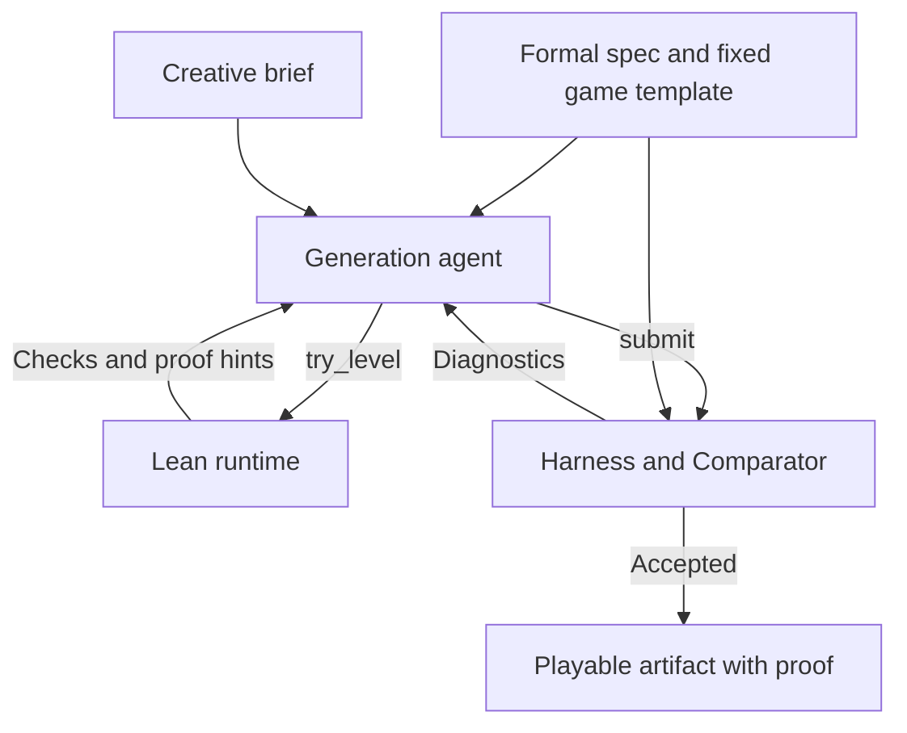
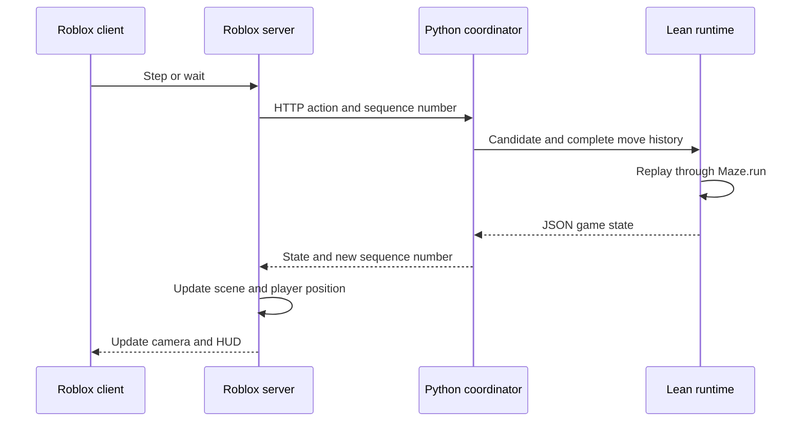

# blox

blox is a system for building playable games from formal specifications. You
describe the experience you want, define what must be true in Lean, and let
agents build a candidate and write its proof. We built a harness that connects
that process to Roblox Studio, so you can play the result under the same
rules that were checked.

You can ask for a puzzle with a guaranteed solution, then change its layout
and cast while keeping that guarantee. Or deliberately build an impossible
level and let players see why it cannot be won.

> **Come find me and I'll show you live.** Right now, I'm the only person with
> the complete setup configured: Roblox Studio, the local Lean runtime, the
> generation tools, and the prepared assets. You can inspect the code and run
> the browser examples from this repo, but those show only part of the
> experience. Bring a game idea or a rule you'd like to test.

## Start with the rules

A game template supplies executable rules: what the state contains, what a
player can do, and how an action changes that state. A formal specification
adds the properties a generated version must satisfy. In this project, that
specification is a Lean file defining `UserSpec.requirement` over the
selected template's `Variant` type.

The current build uses one maze template; each generated variation gets its
own proof.

For example, this [sample requirement](samples/maze/winnable.lean) asks for a
level with a way to win, at least two gems, and at least two guards:

```lean
import Maze.Spec

def UserSpec.requirement (v : Maze.Variant) : Prop :=
  Maze.Winnable v ∧ 2 ≤ v.gems.length ∧ 2 ≤ v.guards.length
```

The agent can choose the layout and patrol routes, but the finished
variation has to satisfy that statement. The template also supplies base
checks for valid data and playability. For this template, those include a
route to the exit with guards removed and a safe first step to another cell.

A separate creative brief describes how the game should look and feel.
Character names, props, colors, and atmosphere guide the presentation.
Only the properties stated in Lean are part of the proof.

## The harness we built

Our Python harness runs the work between a request and a playable result.
It accepts the specification, gives the agent tools to try candidates,
collects proof diagnostics, controls retries, and saves accepted results.
It also manages the sessions that connect Roblox and the browser to the
Lean runtime.

We expose the generation tools through a dedicated MCP server:



| Tool | What the agent gets back |
| --- | --- |
| `try_level` | Checks a proposed variation with the Lean runtime and returns problems, search results, and proof hints. It also flags an already published variation. |
| `submit` | Sends the candidate, presentation data, and complete `Solution.lean` to the judge. A failed attempt returns diagnostics; an accepted attempt creates the playable artifact. |

[app/agent.py](app/agent.py) connects these tools to either Claude Agent SDK
or Codex. The generation agent receives the template guide, the requirement,
and the creative brief. The agent submits data and a proof; the harness
supplies the fixed template and writes the challenge it must satisfy.

The harness runs one generation job at a time, with configurable limits on
attempts, time, and model cost. It feeds errors back into the next attempt
and stops on acceptance, cancellation, or an exhausted budget. If no
candidate passes, the result stays unresolved. Failing to find a proof does
not establish that a specification is impossible.

### From a candidate to a checked game

1. The harness accepts a reviewed sample or an uploaded Lean file. Uploads
   pass through the compiled Lean upload gate, which controls the destination
   and byte limit. The harness then compiles the requirement in a
   `bubblewrap` sandbox and checks its type.
2. The agent submits candidate data. A template adapter turns that data into
   the representation the runtime understands. For the current template,
   `map` and `guards` become a `Maze.Variant`. The Lean runtime prints that
   exact value into `Candidate.lean`.
3. The harness writes the challenge for the candidate. The agent supplies
   the proof in `Solution.lean`. For the current template, the required
   statement is:

   ```lean
   Maze.WellFormed Candidate.variant ∧
   Maze.Playable Candidate.variant ∧
   UserSpec.requirement Candidate.variant
   ```

4. The proposed proof first builds in an isolated sandbox for diagnostics.
   The judge then runs `lake comparator` in a fresh project copy against
   the harness's challenge and permitted axioms. A build alone is not
   acceptance.
5. After Comparator accepts, the harness saves a self-contained project with
   the template sources, toolchain, candidate, requirement, challenge, proof,
   judge log, and a manifest of hashes. Generated results go into
   `artifacts/`; shipped results live in [examples/](examples/). Each can be
   checked again with `lake comparator`.

The code that makes these decisions is in [app/verify.py](app/verify.py).
The agent's success message has no role in accepting a candidate.

## How Roblox talks to Lean

Roblox handles player input, the camera, the scene, and the HUD. Lean
computes the game state. The bridge between them is the local Python
coordinator and Roblox's `HttpService`.

Proof checking happens when a candidate is submitted. During play, compiled
Lean functions execute the rules that the proof refers to. For the current
turn-based template, a move makes this round trip:



The client turns an input into a symbolic move such as `"up"` or `"stay"`
and invokes the Roblox server. The server posts it to
`/api/sessions/<id>/act`. The coordinator checks the sequence number,
appends the action to the session history, and sends one JSON request to the
long-running `maze serve` process.

Inside Lean, `MazeRuntime.replayMoves` reads the move names and calls
`Maze.run` from the initial state. Unknown move names are rejected. The
result includes the player's position, turn, collected items, guard
positions, and game status. Roblox uses those returned values to update
the world and place the player.

Replaying the full history gives each runtime request all the information
it needs. The coordinator can restart the process and replay the request
because the variant and move history fully determine the state. Sequence
checks reject stale actions; restarting a game clears its move history.
Camera turns and map toggles remain local presentation changes.

Before opening a session, the coordinator checks the artifact's template
hash and asks the runtime to print the loaded candidate as Lean source.
That source must hash to the judged `Candidate.lean`. This connects the
selected game data to the accepted proof; the compiler and bridge remain
part of the trusted implementation.

The browser uses the same coordinator and Lean rules. Its **Play in Roblox**
button sends the selected artifact to `/api/roblox/play`; the open Studio
place polls that endpoint and starts the selected level.

The main pieces are [the Roblox server bridge](roblox/src/server/Main.server.luau),
[the coordinator](app/server.py), [the Lean process](templates/maze/MazeMain.lean),
and [the proved replay function](templates/maze/MazeRuntime/Replay.lean).

## How we use Roblox Studio MCP

Studio MCP gives our tooling access to the open Roblox Studio project while
we prepare the game. We use it to find assets, insert them, run Luau, and
inspect the resulting scene. This is a separate connection from the HTTP
bridge used during play.

[app/studio.py](app/studio.py) starts a local launcher for Roblox's Studio
MCP and speaks JSON-RPC over standard input and output. It initializes the
connection and calls Studio tools. [app/dress.py](app/dress.py) uses that
adapter to carry out the scene preparation:

1. `list_roblox_studios` locates the open place, and `get_studio_state`
   confirms that it is in Edit mode.
2. `search_asset` finds Creator Store models for the brief, or the preparation
   step uses asset selections from the level's `decor.json`. `insert_asset`
   brings the models into `ServerStorage.DressPool`.
3. `execute_luau` strips scripts and disallowed instances, anchors parts,
   disables collisions, touch events, and queries, and fits models into
   their allotted space. It also describes each model's tree as JSON.
4. [app/decor_gate.py](app/decor_gate.py) sends that description to the
   compiled Lean decor gate. Accepted models receive a checked node count;
   rejected models are removed.
5. A final sweep checks the prepared pool for disallowed instances before
   it is used by the scene.

This gives us another concrete Roblox-to-Lean path: inspect an asset in
Studio, pass its description to a Lean decision procedure, and use the
answer to decide whether to keep it. The gate's proofs cover that decision
on the reported tree. Studio's reporting code and the actual asset identity
remain trusted.

The generation harness's `try_level` and `submit` tools and Roblox's Studio
MCP have different jobs. The first pair develops and checks the candidate;
the Studio tools prepare its visual world. Scene preparation currently runs
as a separate step in Edit mode. It is not automatically part of every
generation turn.

Keeping imported art inert lets us change a game's appearance while its
movement and win conditions continue to come from Lean. The renderer can
use a different cast or set of props without changing the checked rules.

## Applying the idea to other games

The broader goal is to use this process for any game whose relevant rules
can be expressed in Lean. In the current template, generation changes the
layout, item placement, patrols, and presentation while keeping the
underlying game rules fixed.

A new kind of game needs its own executable rules and `Variant` type,
readable specification predicates, and proof support. It also needs an
adapter for candidate data and a renderer that can display its states and
send its actions. The template registry in [app/verify.py](app/verify.py)
and the adapters in [app/templates.py](app/templates.py) provide the places
to connect those pieces to the harness. Both currently register `maze`.

The current game also makes part of the proof visible through **Show why**.
For a winning level, it replays a route. For an impossible level, it shows
checked regions that contain every surviving player position while
excluding the exit. The runtime checks those regions when the level opens.
That is one way to make a formal guarantee something a player can understand
inside the game.

## What Lean checks

The proofs cover the game rules and specific decisions in the upload and
asset gates. The statements and their definitions are available in the repo.

| Part | What is checked | Where to read it |
| --- | --- | --- |
| Each accepted variation | The level is well formed, has a route to the exit with watchers removed, offers a safe first step to another cell, and satisfies the uploaded requirement. An unwinnable requirement rules out every winning move list, of any length. A winnable requirement supplies a winning route. | [Maze specs](templates/maze/Maze/Spec.lean), [sample requirements](samples/maze/), [shipped proofs](examples/) |
| Gameplay and Show why | Recognized move names replay through `Maze.run`. The region checker is sound: if a certificate passes, escape is impossible, and a player still in the game stays inside the checked region for the current turn. | [Replay](templates/maze/MazeRuntime/Replay.lean), [certificate checker](templates/maze/Maze/Cert.lean) |
| Upload decisions | Client filenames do not affect the destination. Paths have the fixed shape `uploads/<32 lowercase hex digits>/UserSpec.lean`. The byte limit is exact for any chunking, and accepted uploads pass every chunk through in order. The app uses a 64 KiB limit. | [Upload specs and proofs](Specs/UploadSpec/), [upload implementation](app/upload/) |
| Decor decisions | An accepted model tree uses allowed classes, stays within size and depth limits, and has inert parts inside the slot box. The gate also checks asset IDs. | [Decor specs and proofs](Specs/DecorSpec/), [decor implementation](app/decor/) |

The repository's theorem list is in
[Verification/Challenge.lean](Verification/Challenge.lean). `make verify`
prints the axioms and definitions behind the main statements, then runs
Comparator. The judge rejects `sorry`, `native_decide`, and added axioms.

### What is trusted

The proof means what its definitions say. In the current template, being
caught means a guard lands on your cell or you swap cells with one. The
claims concern those turn-based rules. Appearance, fun, character likenesses, and human
reaction time are outside those claims. For an uploaded requirement, the app
shows the requirement itself; it reserves the familiar room labels for the
reviewed samples.

- Lean's kernel and the standard axioms `propext`, `Quot.sound`, and
  `Classical.choice` are trusted. During play, the Lean compiler is also
  trusted to execute the proved functions correctly.
- The Python coordinator, JSON adapters, HTTP, filesystem operations, upload
  read loop, and the call that hands move names to the runtime are outside
  the proofs. The operating system and `bubblewrap` provide isolation while
  uploaded Lean compiles. `make check` exercises the real endpoints and
  checks that the judge rejects invalid submissions.
- The browser, Roblox Studio, Luau scripts, `HttpService`, and the Windows/WSL
  connection draw and transport the game state. They are not formally
  verified. Show why's caption comes from the coordinator; the runtime
  checks the regions used for the display.
- The decor gate checks the model tree reported to it. It trusts the Studio
  tooling to report that tree accurately and use the checked asset. The
  scene compares instance counts when cloning a model; that is not a proof
  of asset identity. Manually cached watcher looks are trusted to have been
  checked. The gate cannot inspect an image or prove that a model resembles
  its name. Material variants use a separate class-and-children filter.
  Roblox, its Creator Store, and the Studio MCP connection remain trusted.
- The generation agent and its search results supply candidates. Acceptance
  depends on the proof check. Decoration is visual only and does not change
  a move, a win, or a watcher's position.

The impossibility certificate ignores gems, so it must establish that the
exit itself is unreachable. See [UPLOAD_SECURITY.md](UPLOAD_SECURITY.md) for
the upload boundary in more detail.

## Running the parts yourself

There is a fair amount to install for the full setup. The browser examples
are the easiest part to run locally. The live walkthrough also needs Roblox
Studio, the generation tools, and the local connections between them.

| What you want to run | What you need |
| --- | --- |
| Browser and shipped rooms | Linux or WSL, `make`, `curl`, Python 3, and Lean. `make install` installs Lean through elan if needed and builds the game with the pinned toolchain. |
| Generating new variations | `bubblewrap`, a Python environment with the Claude Agent SDK, and `ANTHROPIC_API_KEY`. `make install` attempts to set up the environment through `uv` or Python's `venv` and pip. |
| Roblox view | Roblox Studio on Windows, with the coordinator running in WSL. `make roblox` downloads the pinned Rojo and selene tools and the Rojo plugin into `.tools/`, checking their SHA-256 hashes. |
| Creator Store art and dressing | Roblox's Studio MCP, a configured local launcher, access to the assets, and Studio open in Edit mode. The launcher script is not included in the repo; its path is `LAUNCHER` in [app/studio.py](app/studio.py). |

Start the browser app:

```sh
make install && make run
```

Open [http://127.0.0.1:8642](http://127.0.0.1:8642). The shipped rooms play
without a model key or `bubblewrap`. Making new rooms needs the generation
setup above.

To use Codex for generation instead, install `openai-codex` in `.venv`, log in
with its `codex login`, and start the server with `RIGGED_BACKEND=codex make run`.

### Opening the Roblox place

With the coordinator running, use another WSL terminal:

```sh
make roblox
```

Open `build/RiggedArcade.rbxlx` in Roblox Studio on Windows using **File > Open
from File**. Windows can reach it at
`\\wsl$\<your distro>\<path to the repo>\build\RiggedArcade.rbxlx`.
If the coordinator needs another address, build with
`make roblox ROBLOX_URL=http://...`.

For art and props, configure the Studio MCP launcher, then run `make dress`
while Studio is in Edit mode. On the first run, it prints the available
materials. Set `WALL`, `FLOOR`, and `CEILING` in [app/dress.py](app/dress.py)
to the wallpaper, carpet, and ceiling numbers from that list, then run
`make dress` again.

Each run refills `ServerStorage.DressPool`. Cached character looks need to
be added afterwards; `make dress` does not populate `DressPool.Looks`.
Those assets live in the open Studio session and need preparing again when
the place closes. A fresh build uses the built-in materials and shapes until
that setup is done.

Press **Play** (F5). Use W to step, A/D to turn, S to turn around, Space to
wait, R to restart, and M for the map. While Studio is playing, **Play in
Roblox** in the browser sends the selected room to the open place.

The place currently runs in Studio with one player. It is not a published
Roblox experience, and its in-game text does not pass through `TextService`.
That local Studio session, including its prepared artwork, is what I'll
show you in person.

### Useful commands

| Command | Purpose |
| --- | --- |
| `make install` | Set up Lean, build the game and proofs, and attempt to install the generation SDK. |
| `make run` | Start the coordinator and browser app on port 8642. |
| `make verify` | Audit axioms and trusted definitions, then run Comparator on `Verification/`. |
| `make check` | Check the judge, runtime, and upload endpoints with the server running. |
| `make examples` | Rebuild the shipped rooms through the judge. |
| `make roblox` | Build `build/RiggedArcade.rbxlx`. |
| `make roblox-serve` | Sync source changes into Studio through Rojo; art is separate. |
| `make dress` | Prepare the open place's art and props in Edit mode. |

For live source sync, copy `.tools/Rojo.rbxm` into
`%LOCALAPPDATA%\Roblox\Plugins\`, restart Studio, run `make roblox-serve`,
and connect through **Plugins > Rojo** on `localhost:34872`.

## Reading the code

- [templates/maze/](templates/maze/) contains the game rules, specs,
  certificate checker, runtime, and [level design guide](templates/maze/GUIDE.md).
- [app/agent.py](app/agent.py), [app/verify.py](app/verify.py), and
  [app/server.py](app/server.py) handle generation, judging, and play.
- [Verification/](Verification/) contains the repository's proof challenge,
  solution, examples, and audits.
- [samples/maze/](samples/maze/) contains reviewed requirements;
  [examples/](examples/) contains complete judged rooms. Each room is a
  self-contained Lean project where you can run `lake comparator`.
- [roblox/](roblox/) contains the Roblox renderer.

Built for the Vibecheck hackathon. [RULES.md](RULES.md) describes the judging
criteria, and [CLAUDE.md](CLAUDE.md) records the verification guidelines.
[ARCHITECTURE.md](ARCHITECTURE.md) preserves the design history; the current
implementation follows the template workflow described here.

## Art credits

The artwork comes from the Roblox Creator Store and is used inside Roblox
Studio. Model files are not committed to this repo. `make dress` inserts
models into the open place by ID.

- Art kit: Roof Light (12737467199) by SillyGoofyDumb, backrooms monster
  (10699449494) by mihopb1, and Yasu's Backrooms Material Pack
  (89043606186394) by mvyasu.
- Watcher looks in my prepared place: Subaru Natsuki (122480168835819) by
  O_Kar, "annoying robot with bernie sanders face" (1192620519) by Arsaw,
  and Jon Snow (934805927) by Aethanius.
- Other props come from Creator Store searches or each level's `decor.json`.
  The dressing step does not currently record individual prop credits.
- Audio, used by ID: Light Bulb Buzz 2 (9112823813), Command Room Tone Deep
  Air Conditioning Hum (9125446564), and Wall Light Switch 2 (9120484192) by
  ProSoundEffects; Low Drone 42 (1843770413) by APMOfficial.
